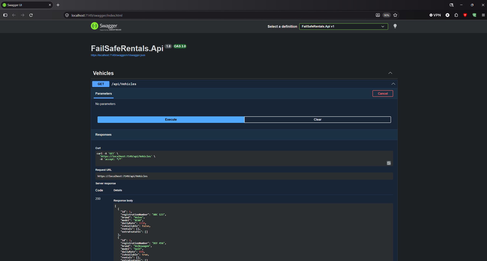
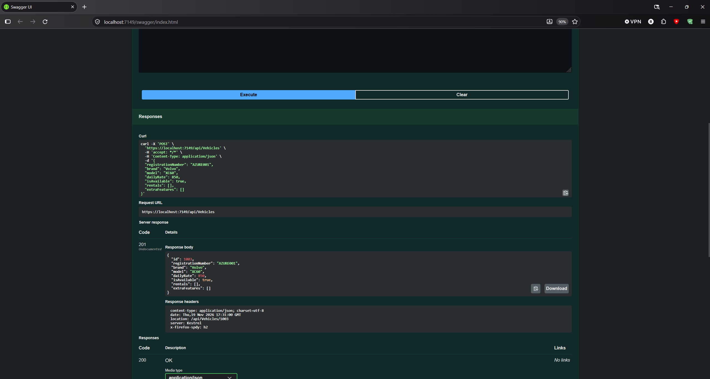
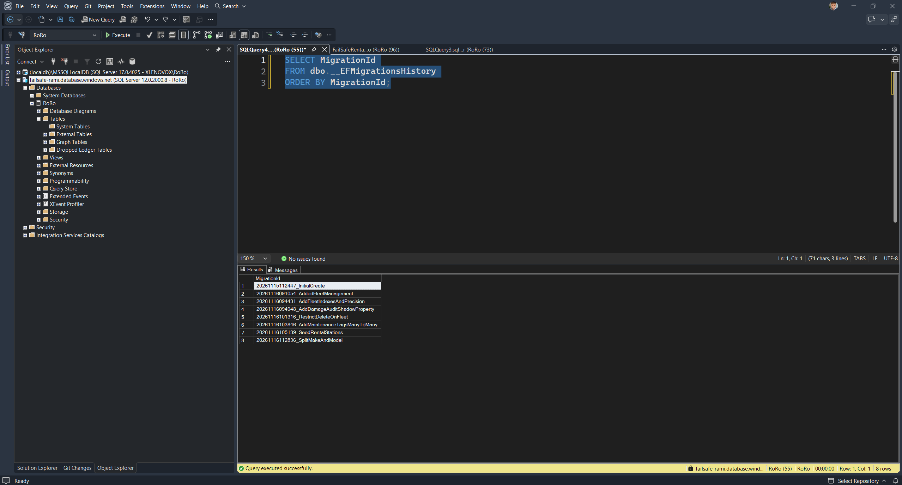
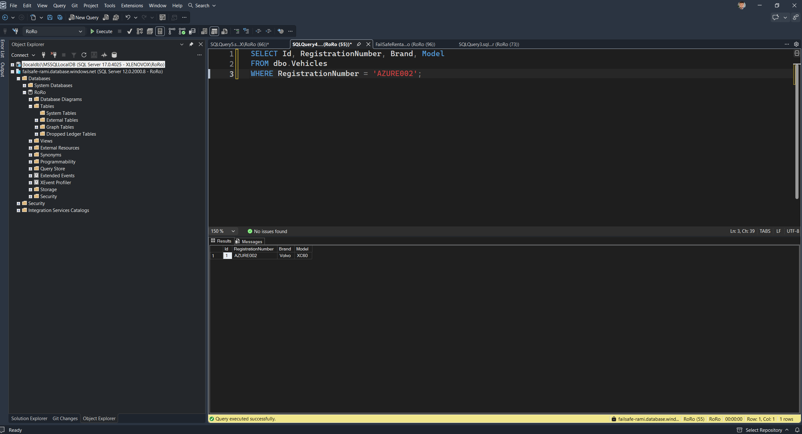

# 05 06 07 Entity Framework

Practical C# and Entity Framework Core coursework developed as part of the KYH Systemutvecklare DevSecOps program.

## Technology Stack

- C# / .NET 11
- Entity Framework Core 11
- SQL Server / Azure SQL
- ASP.NET Core Web API
- Swagger / OpenAPI
- LINQ

## Project Architecture

| Project | Responsibility |
|---|---|
| FailSafeRentals.Core | Domain models and entities |
| FailSafeRentals.Data | DbContext, data access and services |
| FailSafeRentals.ConsoleApp | Console application and EF exercises |
| FailSafeRentals.Api | REST API |

## Lesson 5 – Entity Framework Core

- Code First and DbContext.
- Entity relationships and database migrations.
- Primary keys, foreign keys and indexes.
- Seed data and database configuration.

## Lesson 6 – LINQ and Database Operations

- LINQ queries and filtering.
- CRUD operations.
- Joins and aggregate functions.
- Stored procedures and parameterized SQL.
- RentalService and business logic.

## Lesson 7 – Web API and Azure SQL

### ASP.NET Core Web API

- Controller-based REST API.
- Dependency Injection.
- Swagger / OpenAPI.
- GET and POST endpoints.
- Secure configuration using User Secrets.

### Azure SQL Integration

- Reused existing Azure SQL database `RoRo`.
- Applied all eight EF Core migrations.
- Verified database schema and migration history.
- Successfully tested API operations against Azure SQL.

| Method | Endpoint | Result |
|---|---|---|
| GET | `/api/Vehicles` | HTTP 200 |
| POST | `/api/Vehicles` | HTTP 201 |

### Screenshots

**01 – Swagger GET (HTTP 200)**



**02 – Swagger POST (HTTP 201)**



**03 – Azure SQL migrations**



**04 – Azure SQL data verification**



## Deployment Status

Azure SQL integration is completed and verified.

Azure App Service deployment (tasks 13–15) remains pending due to Azure for Students subscription restrictions and the decision to avoid paid hosting for this educational project.

The API currently runs locally and communicates successfully with Azure SQL.

## Run Locally

Requirements: .NET 11 SDK and SQL Server/LocalDB.

Restore and build:

```powershell
dotnet restore
dotnet build
```

Run the API:

```powershell
dotnet run --project FailSafeRentals.Api/FailSafeRentals.Api.csproj
```

Swagger:

`https://localhost:7149/swagger`

Database connection strings must be configured securely through User Secrets. Never commit credentials to GitHub.

---

**Course:** KYH Systemutvecklare DevSecOps
**Author:** Rami Issa
**Project:** FailSafeRentals
**Lessons:** 05–07