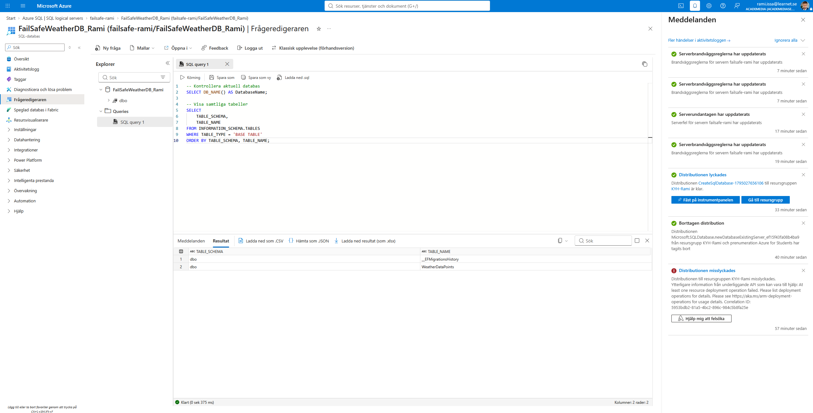
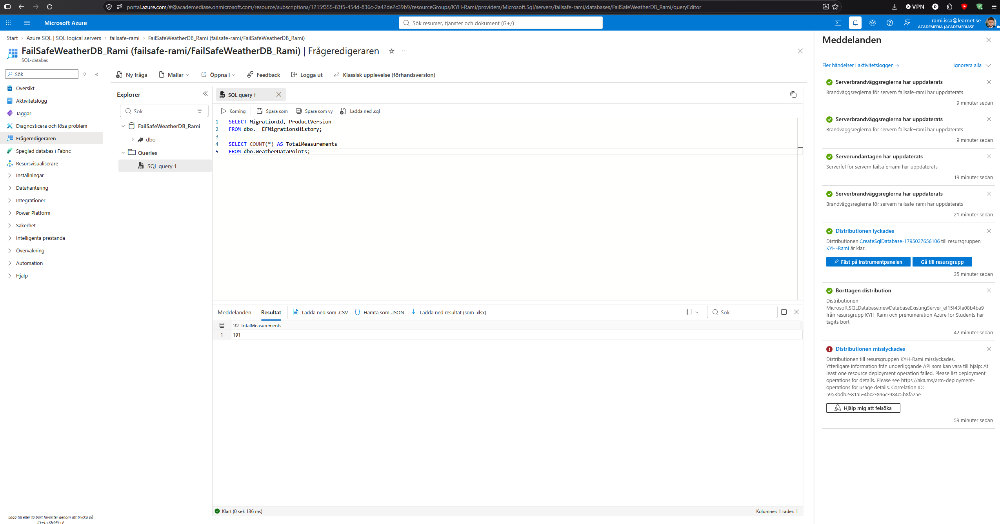
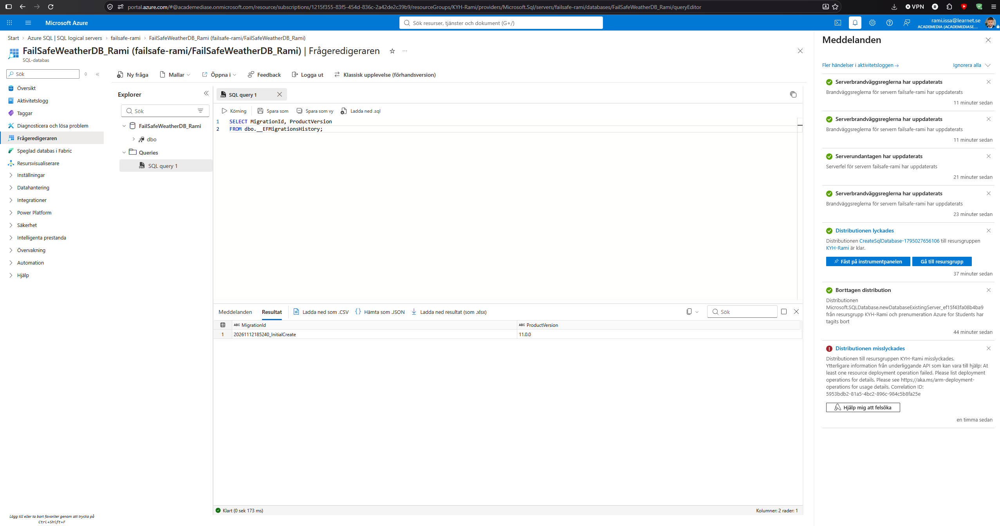
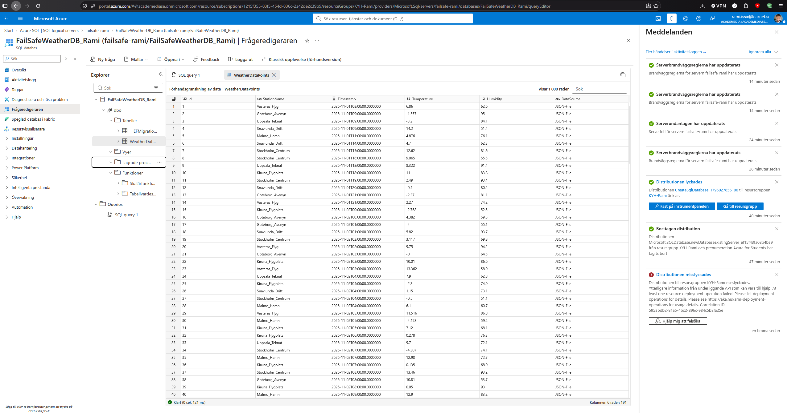

# FailSafe WeatherMonitor

A C# console application built with **.NET 11** for collecting, importing, validating, storing and monitoring weather data.

This project was developed as part of the **Systemutvecklare DevSecOps programme at KYH**.

The application demonstrates object-oriented programming, REST API integration, JSON processing, database management with Entity Framework Core, automated database migrations and Azure SQL integration.

## Technologies

| Technology | Purpose |
|---|---|
| C# / .NET 11 | Application development |
| Entity Framework Core 11 | Object-relational mapping and Code First |
| SQL Server LocalDB | Local development database |
| Azure SQL Database | Cloud database demonstration |
| Spectre.Console | Interactive console interface |
| Open-Meteo API | Live weather data |
| System.Text.Json | JSON processing |
| LINQ | Querying and filtering weather data |

## Features

- Retrieve current weather information using the Open-Meteo API.
- Import historical weather measurements from JSON files.
- Validate incoming weather data before database insertion.
- Detect duplicate records using station name and timestamp.
- Store weather measurements in SQL Server using Entity Framework Core.
- Log rejected records for inspection.
- Display weather information through an interactive console interface.
- Apply EF Core database migrations automatically at startup.
- Support separate Development and Production database configurations.

## Project Structure

```text
Inlamningsuppgift-2/
│
├── Data/
│   ├── WeatherDataContext.cs
│   └── weather_data.json
│
├── Docs/
│   ├── azure-sql-tables.png
│   ├── azure-sql-data.png
│   ├── azure-sql-migration.png
│   └── azure-sql-weather-data.png
│
├── Migrations/
│
├── Models/
│   ├── CurrentWeather.cs
│   ├── OpenMeteoResponse.cs
│   └── WeatherDataPoint.cs
│
├── Services/
│   ├── ImportService.cs
│   ├── WeatherApiService.cs
│   └── WeatherService.cs
│
├── UI/
│   ├── AppTheme.cs
│   ├── Menu.cs
│   ├── NoticeType.cs
│   └── WeatherScreen.cs
│
├── Program.cs
├── appsettings.json
├── appsettings.Production.json
└── README.md
```

## Getting Started

### Requirements

- .NET 11 SDK
- SQL Server LocalDB
- Visual Studio 2026 or another compatible development environment

### Installation

Clone the repository:

```powershell
git clone https://github.com/KYH-RAMI/SQL.git
```

Navigate to the application:

```powershell
cd SQL\Inlamningsuppgift-2
```

Restore dependencies:

```powershell
dotnet restore
```

Build the application:

```powershell
dotnet build
```

Start the application:

```powershell
dotnet run
```

The application uses the Development configuration by default.

## Database Configuration

The application supports two database environments.

| Environment | Database | Configuration |
|---|---|---|
| Development | SQL Server LocalDB | `appsettings.json` |
| Production | Azure SQL Database | `appsettings.Production.json` |

### Development

Development is the default environment.

If `WEATHERMONITOR_ENVIRONMENT` is not defined, the application uses the local SQL Server database configured in `appsettings.json`.

This allows the application to run locally without requiring an Azure subscription.

### Production

Production mode is selected using the environment variable:

```powershell
$env:WEATHERMONITOR_ENVIRONMENT="Production"
```

The Azure SQL password is supplied separately through an environment variable rather than being stored directly in the configuration file.

```powershell
$env:WEATHERMONITOR_SQL_PASSWORD="<your-password>"
```

**Important:** The original Azure demonstration database has since been renamed and cleared. The included Production configuration references the original demonstration database and is therefore not currently operational without reconfiguration.

The Azure implementation and migration evidence are retained for documentation purposes.

## Automatic Database Migrations

The application uses **Entity Framework Core Code First**.

Database migrations are applied automatically when the application starts.

The startup logic includes:

```csharp
await using (var db = new WeatherDataContext())
{
    await db.Database.MigrateAsync();
}
```

This allows EF Core to create or update the database schema using the migrations included in the project.

The initial migration was created using EF Core 11.

Migration identifier:

```text
20261112185240_InitialCreate
```

The migration was successfully applied to both the local SQL Server environment and the Azure SQL demonstration database.

## JSON Import and Validation

The application imports historical weather measurements from a JSON file.

During the verified import:

| Result | Records |
|---|---:|
| Total input records | 200 |
| Successfully imported | 191 |
| Rejected during validation | 9 |

Invalid records are excluded from the database import and logged for inspection.

The import process also handles data formatting issues and duplicate detection.

## Azure SQL Demonstration

As part of the project's cloud database requirements, the application was configured and tested against **Microsoft Azure SQL Database**.

### Azure Environment

| Property | Value |
|---|---|
| Cloud provider | Microsoft Azure |
| Service | Azure SQL Database |
| Logical SQL server | `failsafe-rami.database.windows.net` |
| Original demonstration database | `FailSafeWeatherDB_Rami` |
| Database framework | Entity Framework Core 11 |
| Migration | `20261112185240_InitialCreate` |

### Verified Results

The following operations were completed successfully:

1. Created and configured an Azure SQL Database.
2. Connected the application to Azure SQL using a separate Production configuration.
3. Applied the existing EF Core migration to the cloud database.
4. Verified the `__EFMigrationsHistory` table.
5. Verified the `WeatherDataPoints` table.
6. Imported and verified **191 weather measurements** in Azure SQL.

### Azure SQL – Database Tables

The following screenshot shows the database tables created through EF Core migrations.



### Azure SQL – Imported Records

The following screenshot documents the successful import of 191 weather measurements.



### Azure SQL – EF Core Migration

The migration history confirms that the initial migration was applied using Entity Framework Core 11.



### Azure SQL – Weather Measurements

The following screenshot shows weather measurements stored in the Azure SQL database.



### Azure Demonstration Status

After the successful demonstration, the Azure SQL tables were removed and the database was renamed to `RoRo` for reuse in future projects.

The screenshots above document the completed migration and data import.

**The Azure SQL demonstration was completed successfully, but the original WeatherMonitor tables are no longer present in the current cloud database.**

The local Development database and the project's EF Core migrations remain available.

## Security Considerations

The application separates local development settings from the cloud database configuration.

Security measures include:

- Keeping the Azure SQL password out of the committed configuration files.
- Supplying the Production password through an environment variable.
- Using encrypted SQL Server connections for Azure.
- Disabling trusted server certificates for Azure SQL connections.
- Requiring explicit selection of the Production environment.
- Using LocalDB as the default development environment.

Production credentials should never be committed to GitHub.

## Project Status

The project includes the local database implementation, JSON import functionality, API integration, automated EF Core migrations and documented Azure SQL deployment.

The Azure deployment was verified during development. Its original database was subsequently cleared and repurposed.

This repository contains the source code and supporting documentation for **Inlämningsuppgift 2** in the Systemutvecklare DevSecOps programme at KYH.

**Author:** Rami Issa