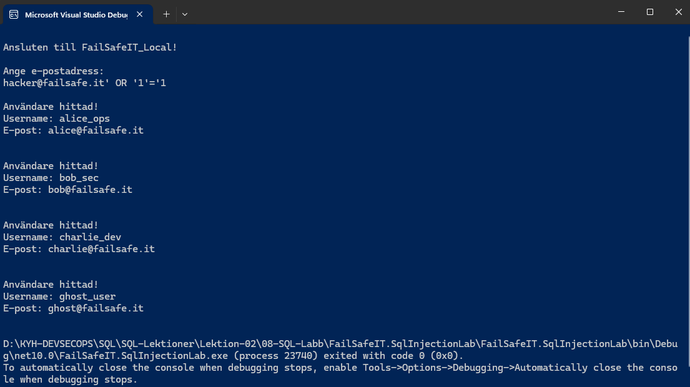

# Uppgift 9 – SQL Injection

## Vad har jag gjort?

Jag testade om mitt C#-program gick att lura genom att skriva in något annat än en vanlig e-postadress.

Programmet ska egentligen bara söka efter en användare och visa den personens uppgifter.

## Test 1 – Vanlig sökning

Jag skrev in:

`alice@failsafe.it`

**Resultat:** Programmet hittade Alice och visade hennes användarnamn och e-postadress.

## Test 2 – SQL Injection

Jag skrev i stället:

`hacker@failsafe.it' OR '1'='1`

**Resultat:** Programmet visade alla fyra användare, trots att e-postadressen inte finns.

### Resultat från testet

## Varför hände det?

Problemet är att programmet använder texten jag skriver direkt i sin databasfråga.

Genom att lägga till `OR '1'='1` kunde jag lura databasen att visa alla användare i stället för bara en.

## Slutsats

Testet visar att programmet har en säkerhetsbrist som kallas SQL Injection.

I uppgift 10 ska jag fixa problemet med `SqlParameter`, så att användarens text inte längre kan ändra databasfrågan.
